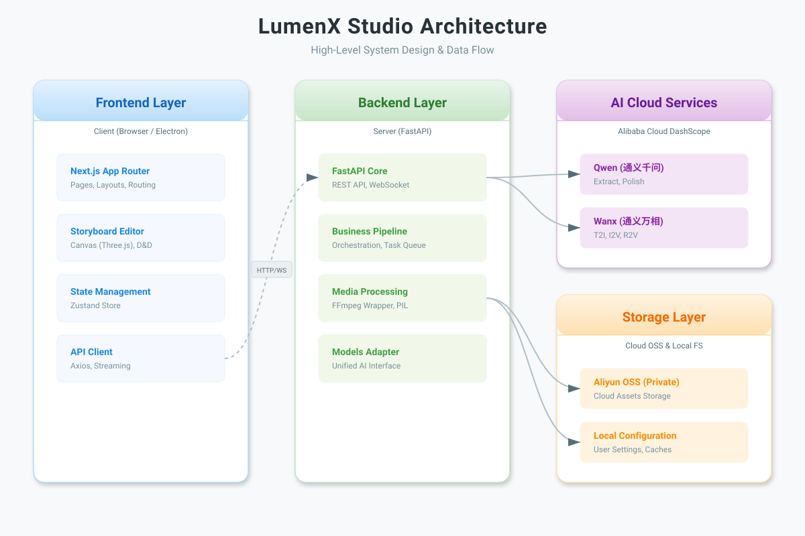
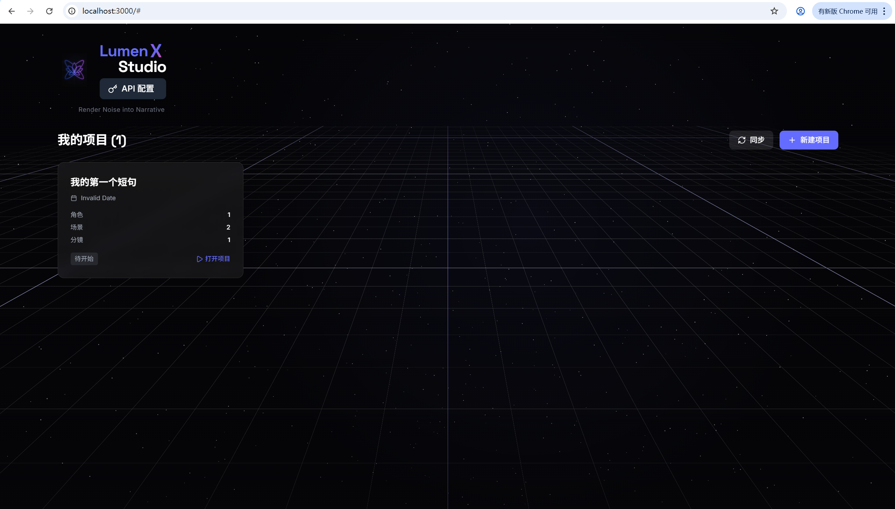
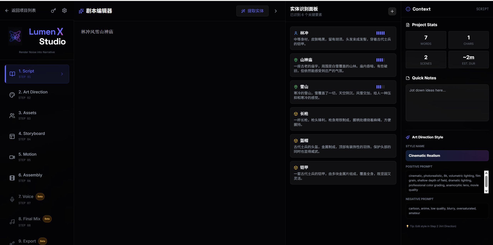
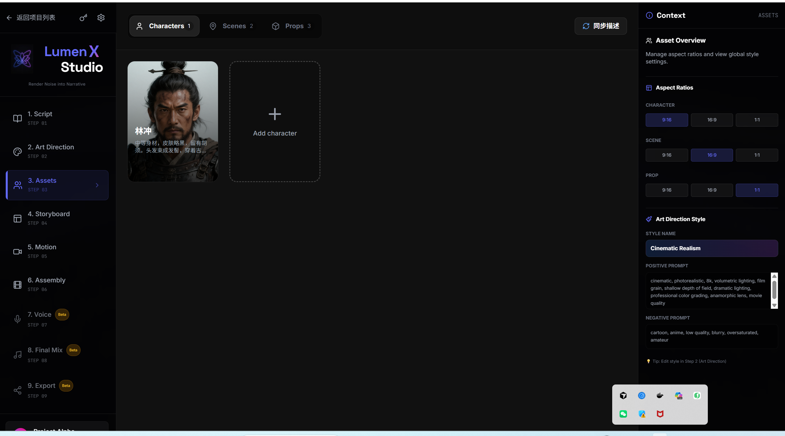

# 项目介绍

## 1. 项目背景与目标

本项目旨在解决短漫剧创作过程中的技术瓶颈和效率问题。随着AI技术的快速发展，短视频和动漫内容创作需求激增，但传统创作流程存在以下痛点：
- 剧本分析依赖人工经验，缺乏深度语义理解
- 美术指导难以量化控制，风格一致性差
- 分镜设计耗时耗力，可视化程度低
- 多模态内容生成缺乏统一平台

项目目标是构建一个AI驱动的短漫剧一站式生产平台，通过集成多种AI模型和工具，实现从剧本输入到最终内容输出的全流程自动化和智能化，提升创作效率和质量。

## 2. 项目应用场景

系统适用于以下实际应用场景：

- **深度剧本分析**：对剧本文本进行语义分析、情感识别、角色关系提取，为后续创作提供数据基础
- **可控美术指导**：基于剧本内容生成美术风格指导，支持风格参数调整和一致性控制
- **可视化分镜**：自动生成故事板分镜，支持手动调整和预览
- **多模态生成**：集成文本、图像、音频等多种模态的AI生成能力，输出完整的短漫剧内容

## 3. 核心功能概述

- **剧本管理**：支持剧本上传、编辑和版本控制
- **AI分析引擎**：集成深度学习模型进行剧本语义分析
- **美术指导生成**：基于剧本自动生成美术风格参数
- **分镜可视化**：提供交互式分镜设计和预览工具
- **多模态合成**：支持文本到图像、文本到音频的生成
- **资产管理**：集成OSS存储，管理生成的内容资产
- **配置管理**：提供环境变量和API密钥的安全配置界面

## 4. 主要技术栈

- **编程语言**：Python (后端), TypeScript (前端)
- **后端框架**：FastAPI
- **前端框架**：Next.js, React
- **样式框架**：Tailwind CSS
- **数据库**：阿里云OSS (对象存储)
- **AI模型集成**：
  - DashScope (通义千问系列模型)
  - Kling (视频生成)
  - WanX (图像生成)
  - Qwen-VL (多模态理解)
- **中间件**：无
- **部署工具**：PyInstaller (桌面应用打包)

## 5. 系统界面预览







.png)



.png)

## 6. 项目使用指南

### 6.1 环境要求

- **操作系统**：Windows 10+, macOS 10.15+, Linux (Ubuntu 18.04+)
- **运行环境**：
  - Python 3.8+
  - Node.js 18+
  - npm 或 yarn
- **依赖组件**：
  - FFmpeg (已包含在bin目录)
  - WebView2 (Windows自动安装)

### 6.2 启动步骤

```bash
# 1. 克隆项目
git clone <repository-url>
cd welwitschia-mirabilis

# 2. 安装后端依赖
pip install -r requirements.txt

# 3. 安装前端依赖
cd frontend
npm install
cd ..

# 4. 修改配置
# 编辑环境变量配置文件，设置API密钥和OSS配置
# 参考 frontend/src/components/project/EnvConfigDialog.tsx 中的配置项

# 5. 启动后端服务
./start_backend.sh  # Linux/macOS
# 或
.\start_backend.ps1  # Windows

# 6. 启动前端服务
./start_frontend.sh  # Linux/macOS
# 或在frontend目录下运行 npm run dev
```

### 6.3 访问地址

- **前端界面**：http://localhost:3000
- **后端API**：http://localhost:8000
- **API文档**：http://localhost:8000/docs (Swagger UI)

### 6.4 默认账号说明

系统暂无内置默认账号。首次使用需通过前端界面配置环境变量，包括：
- DashScope API Key
- 阿里云Access Key ID/Secret
- OSS Bucket配置

生产环境部署时，请确保使用强密码并定期轮换API密钥。

## 7. 典型使用流程

1. **环境配置**：首次启动时，通过界面配置必要的API密钥和OSS参数
2. **剧本上传**：在剧本管理页面上传或输入剧本文本
3. **深度分析**：系统自动进行剧本语义分析，提取角色、情感、场景信息
4. **美术指导**：基于分析结果生成美术风格参数，支持手动调整
5. **分镜设计**：自动生成故事板分镜，用户可交互式编辑
6. **内容生成**：触发多模态生成，包括图像、音频等资产
7. **资产管理**：生成的內容自动上传到OSS存储，支持下载和复用
8. **导出成品**：将完整短漫剧内容导出为标准格式

## 8. 演示视频

[通过网盘分享的文件：lumen.mp4
链接: https://pan.baidu.com/s/1LKLGoo9-0qhc7Oxkd23yYA?pwd=ab1c 提取码: ab1c]

## 9. 下载与安装

项目提供预编译的桌面应用版本，支持一键下载和安装。

[下载最新版本](https://github.com/your-repo/releases/download/v1.0/welwitschia-mirabilis-setup.exe) (Windows)

[下载最新版本](https://github.com/your-repo/releases/download/v1.0/welwitschia-mirabilis.dmg) (macOS)

[下载最新版本](https://github.com/your-repo/releases/download/v1.0/welwitschia-mirabilis.AppImage) (Linux)

*注意：请替换上述链接为实际的发布地址。*
